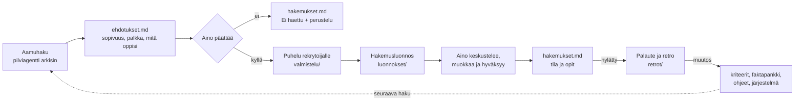

# Työnhaku

*Päivitetty: 2026-11-09 · Esimerkkidataa: Aino Esimerkki ja kaikki työnantajat ovat keksittyjä.*

Työnhaku on Työ / ura -alueen projekti. Tekoäly tekee taustatyön, **Aino tekee päätökset ja on jokaisen
hakemuksen takana**.

## Miten se toimii

1. **Aamuhaku** (ajastettu pilviagentti, arkisin ennen klo 8) käy läpi uudet ilmoitukset
   [hakukriteerien](hakukriteerit.md) perusteella ja kirjoittaa raportin kansioon [aamuhaut/](aamuhaut/).
2. **Ehdotukset** kootaan [ehdotukset.md](ehdotukset.md):hen: sopivuus, palkka suhteessa vastuuseen ja mitä oppisi.
3. **Aino päättää**, haetaanko. Päätös ja perustelu kirjataan [hakemukset.md](hakemukset.md):hen.
4. **Puhelu ensin.** Agentti valmistelee kysymykset lisätietopuheluun ([valmistelu/](valmistelu/)).
5. **Hakemusluonnos** syntyy repoon kootusta kontekstista: [faktapankki](faktapankki.md), ilmoitus, puhelun
   havainnot ja [kirjoitusohjeet](kirjoitusohjeet.md). Luonnos ei ole hakemus: Aino keskustelee siitä,
   päättää painotukset, muokkaa ja lähettää itse.
6. **Seuranta ja opit**: tila päivittyy taulukkoon.
7. **Inspect and adapt**: jos paikkaa ei tule, palaute ja retro, ja niiden perusteella muutos (ks. alla).

## Säännöt, jotka pitävät avustajan rehellisenä
- **Faktat vain [faktapankista](faktapankki.md).** Siellä on myös lista asioista, joita *ei* saa väittää.
- **Hakukriteerit ovat tiedostossa**, ei agentin ohjeessa, joten niitä voi muuttaa yhdestä paikasta.
- **Agentti kirjoittaa vain tähän kansioon** ja pushaa itse. Työohje: [pilvisessio.md](pilvisessio.md).

## Tilannekuva (2026-11-09)
- 9 roolia tarkasteltu, 4 käynnissä, 3 ei haettu, 2 hylätty.
- Seuraava deadline: 2026-11-16 (Esimerkkikaupunki, tekoälyn kehityspäällikkö).

## Inspect and adapt: retro jokaisesta hylkäyksestä
Jos paikkaa ei tule, haku ei mene hukkaan: siitä opitaan, ja opit parantavat sekä työnhakua että tätä järjestelmää.

1. **Palaute.** Kun tila muuttuu `Hylätty`, Aino pyytää palautteen rekrytoijalta 1–2 viikon sisällä, mieluiten
   puhelimessa: mikä ratkaisi, mikä oli heikoin kohta ja mitä valittu toi.
2. **Retro** (noin 15 min) kansioon [retrot/](retrot/) pohjalla [retrot/pohja.md](retrot/pohja.md).
3. **Muutos oikeaan paikkaan.** Jokainen retro päättyy vähintään yhteen konkreettiseen muutokseen:
   [hakukriteerit](hakukriteerit.md), [faktapankki](faktapankki.md), [kirjoitusohjeet](kirjoitusohjeet.md),
   valmistelun tapa, [agentin työohje](pilvisessio.md) tai itse järjestelmä.
4. **Opit-listaan** yksi rivi ja linkki retroon.

Viikkokatselmoinnissa tarkistetaan, onko retroja tekemättä tai palautteita pyytämättä.
Esimerkki: [retrot/2026-10-30-kuvitelma-logistics-service-design-lead.md](retrot/2026-10-30-kuvitelma-logistics-service-design-lead.md).

## Opit
- **Puhelu ennen hakemusta kannattaa.** Puhelun havainto hakemuksessa erottaa muista.
- **Logistiikka-alan rooleissa toimialatausta painaa** ([retro](retrot/2026-10-30-kuvitelma-logistics-service-design-lead.md)):
  hakukriteereihin lisättiin ⚠️-merkintä, kun ilmoitus edellyttää toimialakokemusta.
- **Kysy hands-on-vaatimus heti**, jos ilmoitus puhuu "rakentamisesta": rakennetaanko itse vai johdetaanko rakentajia.
