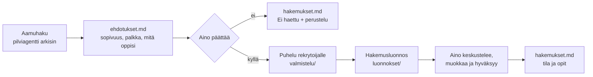

# Työnhaku

*Päivitetty: 2026-11-09 · Esimerkkidataa: Aino Esimerkki ja kaikki työnantajat ovat keksittyjä.*

Työnhaku on Työ / ura -alueen projekti. Tekoäly tekee taustatyön, **Aino tekee päätökset ja on jokaisen
hakemuksen takana**.

## Miten se toimii

1. **Aamuhaku** (ajastettu pilviagentti, arkisin ennen klo 8) käy läpi uudet ilmoitukset
   [hakukriteerien](hakukriteerit.md) perusteella ja kirjoittaa raportin kansioon [aamuhaut/](aamuhaut/).
2. **Ehdotukset** kootaan [ehdotukset.md](ehdotukset.md):hen: sopivuus, palkka suhteessa vastuuseen ja mitä oppisi.
3. **Aino päättää**, haetaanko. Päätös ja perustelu kirjataan [hakemukset.md](hakemukset.md):hen.
4. **Puhelu ensin.** Agentti valmistelee kysymykset lisätietopuheluun ([valmistelu/](valmistelu/)).
5. **Hakemusluonnos** syntyy repoon kootusta kontekstista: [faktapankki](faktapankki.md), ilmoitus, puhelun
   havainnot ja [kirjoitusohjeet](kirjoitusohjeet.md). Luonnos ei ole hakemus: Aino keskustelee siitä,
   päättää painotukset, muokkaa ja lähettää itse.
6. **Seuranta ja opit**: tila päivittyy taulukkoon, ja jokaisesta hausta kirjataan oppi alle.

## Säännöt, jotka pitävät avustajan rehellisenä
- **Faktat vain [faktapankista](faktapankki.md).** Siellä on myös lista asioista, joita *ei* saa väittää.
- **Hakukriteerit ovat tiedostossa**, ei agentin ohjeessa, joten niitä voi muuttaa yhdestä paikasta.
- **Agentti kirjoittaa vain tähän kansioon** ja pushaa itse. Työohje: [pilvisessio.md](pilvisessio.md).

## Tilannekuva (2026-11-09)
- 9 roolia tarkasteltu, 4 käynnissä, 3 ei haettu, 2 hylätty.
- Seuraava deadline: 2026-11-16 (Esimerkkikaupunki, tekoälyn kehityspäällikkö).

## Opit
- **Puhelu ennen hakemusta kannattaa.** Puhelun havainto hakemuksessa erottaa muista.
- **Kysy hands-on-vaatimus heti**, jos ilmoitus puhuu "rakentamisesta": rakennetaanko itse vai johdetaanko rakentajia.
