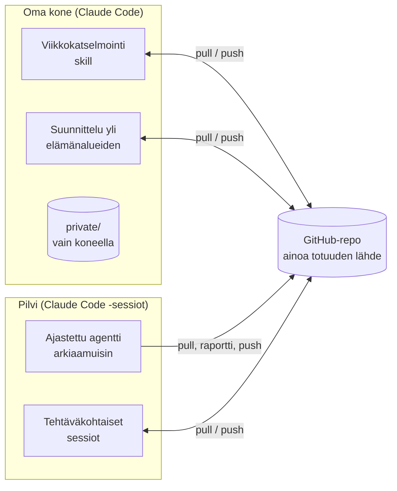

# Arkkitehtuuri

## Periaate: Git-repo on ainoa totuuden lähde

Kaikki pysyvä tieto on Markdown-tiedostoina yhdessä Git-repossa. Tekoäly ei luota keskustelun
muistiin: jokainen sessio aloittaa `git pull`illa, lukee tarvitsemansa tiedostot ja tallentaa
päätökset takaisin committeina. Historia näkyy Gitissä, ja tiedostoja voi muokata myös käsin
(esim. Obsidianissa).

## Työtilat

| Työtila | Mitä tekee | Mihin kirjoittaa |
|---|---|---|
| **Claude Code omalla koneella** | Viikkokatselmointi, suunnittelu yli elämänalueiden, paperimuistiinpanojen tuonti | Koko repo + `private/` (ei Gitissä) |
| **Ajastettu pilviagentti** | Työnhaun aamuhaku arkisin ennen klo 8: hakee uudet tiedot, arvioi ne alueen kriteereillä ja kirjoittaa raportin | Vain oman alueensa kansio |
| **Tehtäväkohtainen pilvisessio** | Yksi rajattu tehtävä (esim. valmistelu tapaamiseen) | Vain oman alueensa kansio |

Pilviagenteilla ei ole pääsyä `private/`-kansioon eikä koneen tiedostoihin. Jokaisella agentilla on
oma työohjeensa alueen kansiossa, ja se lukee sen ennen kuin tekee mitään.

## Ohjauksen kerrokset

1. **`CLAUDE.md`**: pysyvät toimintaperiaatteet (tiedostot ovat totuus, kirjaa päätökset,
   realistisuus, tietosuoja).
2. **Skillit** (`.claude/skills/`): toistuvat rutiinit vaiheittain, esim. viikkokatselmointi.
3. **Alueiden README:t**: tavoitteet, linkitykset ja nykytila. Tarkin lähde.
4. **Agenttien työohjeet**: mitä agentti saa lukea ja mihin kirjoittaa.

## Tietosuoja

- Oikeassa käytössä repo on yksityinen. Arkaluonteisin tieto on `private/`-kansiossa, joka ei mene Gitiin.
- Repoon ei kirjoiteta tunnuksia, tili- tai korttinumeroita eikä terveysasiakirjoja.
- Tämä julkinen malli on täytetty keksityllä datalla. Julkaisua ennen ajetaan tarkistus, joka etsii
  henkilötietoja (puhelinnumerot, sähköpostit, henkilötunnukset, tilinumerot ja erillinen kieltolista).
